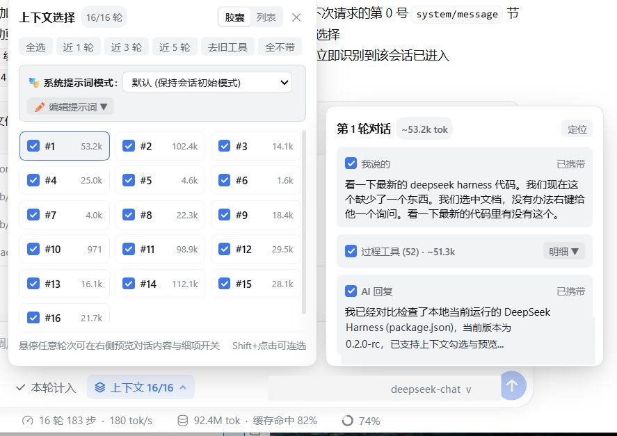
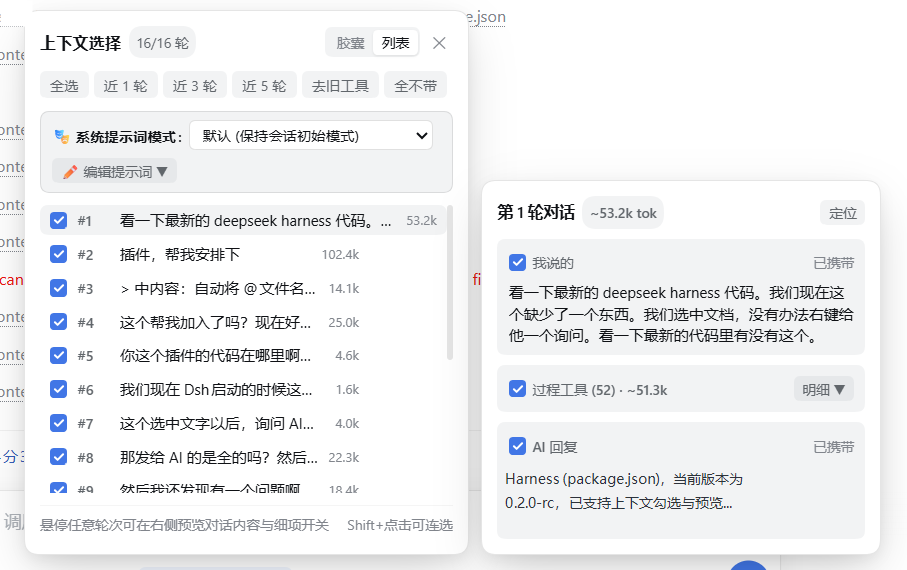
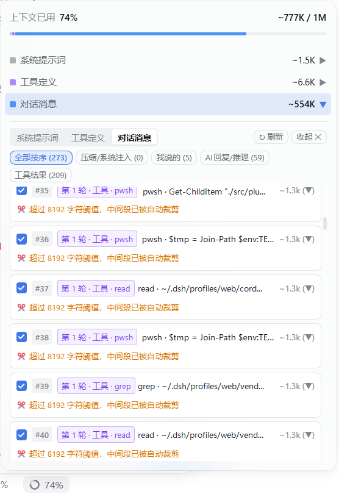
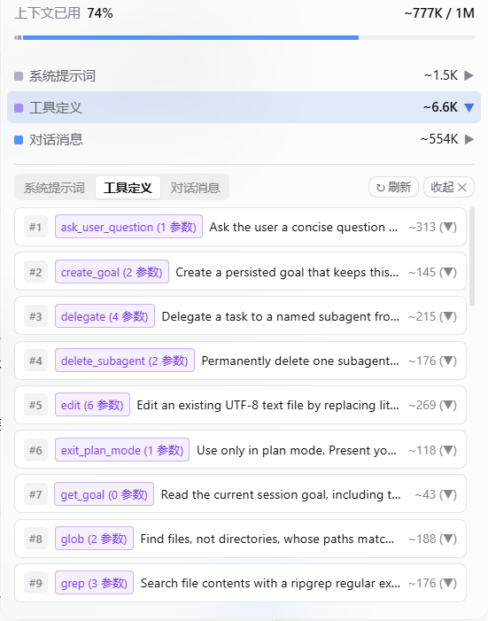

# dsh-context-selector

**Language / 语言**: [简体中文](./README.md) | **English**

**dsh-context-selector** is a **custom context selection and management plugin** built for **DeepSeek Harness (DSH)**.  
It lets you **selectively choose which parts of your chat history are sent to subsequent turns**—whether whole turns, individual user/assistant messages, specific tool call outputs, or system prompt sections—giving you full, fine-grained control over your context window.

---

## Key Features

- **Selective Chat History Sending (Turn / Message / Tool Level)**  
  Switch seamlessly between **Capsule** and **List** views. Toggle entire turns with one click, or hover over any turn to preview its contents on the right and individually include/exclude **User Messages**, **Tool Calls**, or **AI Replies**. Built-in quick actions include `All`, `Last 1/3/5`, `Prune Old Tools`, `None`, `Cutoff From Turn`, and `Ephemeral Next Turn`.
- **Custom System Prompt & Live Mode Switching**  
  Switch system prompt presets mid-session or **append / completely replace** the system prompt with your own custom instructions—and even toggle individual system prompt paragraphs on or off—taking effect immediately on the next turn.
- **Context Usage Inspector & Per-Item Toggles**  
  Click the context usage ring in the bottom status bar to inspect exact token usage across **System Prompt**, **Tool Definitions**, and **Conversation Messages**, filter by category, and toggle individual messages or tool outputs.
- **Right-Click "Ask AI" on Files & Text Selections**  
  Right-click any file, folder, document preview, or selected text to quote and reference it directly in the chat input.

---

## Screenshots

### 1. Context Selector Panel (Capsule & List Views + Hover Preview)

Open the **Context Selector** popover above the composer to switch between **Capsule** and **List** views, and hover over any turn to preview and toggle its individual messages and tool calls:





### 2. Context Usage Inspector (Per-Message Toggles & Tool Definitions)

Click the context percentage in the bottom status bar to inspect and toggle individual conversation messages/tool results or browse registered tool definitions:

| Conversation Messages & Per-Item Toggles | Tool Definitions & Token Breakdown |
| :---: | :---: |
|  |  |

---

## Installation

### Option 1: Install via DSH Plugin Manager (Recommended)

1. Open DeepSeek Harness Settings -> **Plugins**.
2. Upload the release package `dsh-context-selector-2.3.0.tgz`.
3. Enable the plugin and refresh the page.

### Option 2: Manual Installation

1. Extract or clone this repository into:
   - Windows: `%USERPROFILE%\.dsh\profiles\web\vendor\dsh-context-selector`
   - macOS / Linux: `~/.dsh/profiles/web/vendor/dsh-context-selector`
2. Add the plugin entry to `~/.dsh/profiles/web/cordis.patch.yml`:
   ```yaml
   - insert:
       - id: context-selector
         name: 'dsh-context-selector'
         config: {}
   ```
3. Restart DeepSeek Harness.

---

## Slash Commands (Optional)

| Command | Description |
| :--- | :--- |
| `/ctx` or `/ctx list` | Show current turn selection status and token summary |
| `/ctx all` / `/ctx none` | Include all turns / Exclude all history turns |
| `/ctx last <N>` | Keep only the last `N` turns (e.g., `/ctx last 3`) |
| `/ctx from <M>` | Cutoff history before turn `M` |
| `/ctx toggle <N>` | Toggle inclusion of turn `N` |
| `/ctx tools [N]` | Exclude tool call outputs from older turns, keeping only the last `N` turns |
| `/ctx once [on\|off]` | Toggle ephemeral mode for the next turn |

---

## License

[MIT](./LICENSE)
