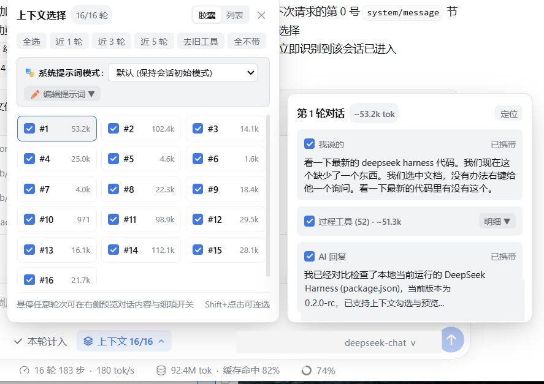
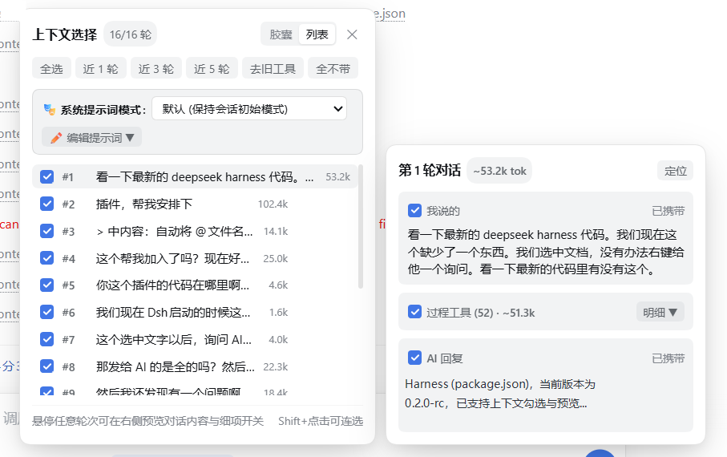
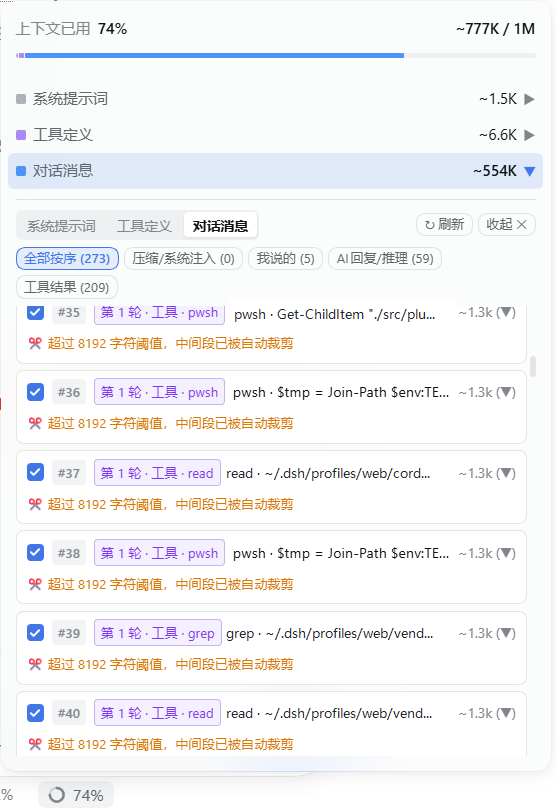
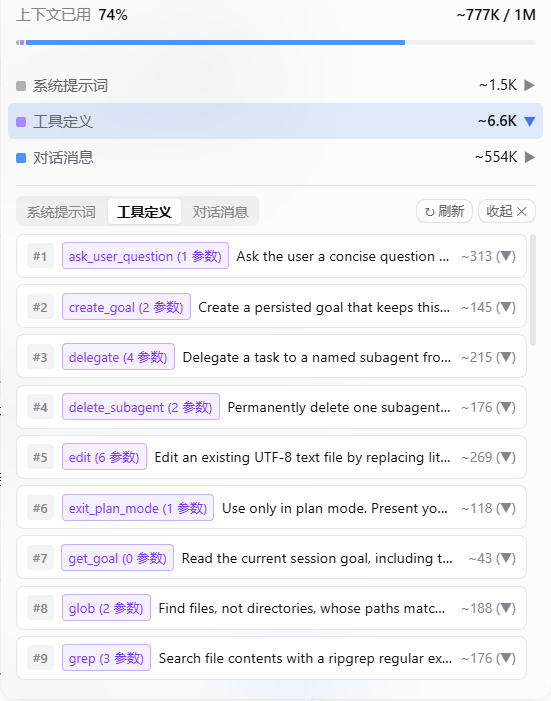

# dsh-context-selector

**Language / 语言**: **简体中文** | [English](./README.en.md)

**dsh-context-selector** 是专为 **DeepSeek Harness (DSH)** 打造的**自定义上下文选择与管理插件**。  
它的核心作用是让你**自由、有选择性地决定将哪些历史聊天内容发送给后续轮次的对话**——无论是整轮对话、某条提问/回复、单次工具调用结果，还是系统提示词，都可以按需勾选或排除，实现真正的**自定义上下文**。

---

## 核心功能

- **选择性发送历史对话（整轮 / 单条 / 工具级）**  
  支持**胶囊**与**列表**两种视图，可按轮次一键勾选/取消，也可将鼠标悬停在任意轮次上，在右侧预览卡片中单独勾选或排除**「我说的」**、**「过程工具」**或**「AI 回复」**。提供 `全选`、`近 1/3/5 轮`、`去旧工具`、`全不带`、`从本轮起截断` 与 `仅本轮有效（阅后即焚）` 等快捷操作。
- **自定义与随时切换系统提示词**  
  无需新建会话，可在当前对话中随时切换系统提示词预设模式，或直接**追加 / 完全替换**自定义系统提示词，并在提示词面板中按段落勾选需要携带的内容，下一轮对话立即生效。
- **上下文用量透视与细项开关**  
  点击底部状态栏的上下文百分比环，即可直观查看**系统提示词**、**工具定义**与**对话消息**的 Token 占用明细，支持按分类筛选（全部按序、压缩/系统注入、我说的、AI 回复/推理、工具结果）并逐条勾选或展开查看详情。
- **文档与划词右键「询问 AI」**  
  在文件树、文档预览区或选中任意文本时右键即可一键引用并填入输入框，配合上下文选择器高效提问。

---

## 界面预览

### 1. 上下文选择面板（胶囊视图 & 列表视图 + 右侧悬停细项预览）

在输入框上方打开**「上下文选择」**面板，可自由切换**胶囊**或**列表**视图；悬停任意轮次即可在右侧预览该轮对话详情，并单独控制是否携带你的提问、过程工具调用或 AI 回复：





### 2. 上下文透视面板（对话消息逐条开关 & 工具定义明细）

点击底部状态栏百分比即可展开上下文构成明细，按类别筛选并逐条勾选需要发送给下一轮对话的消息或工具结果，同时可查看所有注册工具的参数与 Token 占比：

| 对话消息明细与逐条勾选 | 工具定义与 Token 占用明细 |
| :---: | :---: |
|  |  |

---

## 安装方式

### 方式一：通过 DSH 插件管理器安装（推荐）

1. 打开 DeepSeek Harness 设置 -> **Plugins（插件）**。
2. 点击上传并选择发布包 `dsh-context-selector-2.2.0.tgz`。
3. 启用插件后刷新页面即可使用。

### 方式二：手动安装到 DSH Profile

1. 将本仓库解压或克隆到：
   - Windows: `%USERPROFILE%\.dsh\profiles\web\vendor\dsh-context-selector`
   - macOS / Linux: `~/.dsh/profiles/web/vendor/dsh-context-selector`
2. 在 `~/.dsh/profiles/web/cordis.patch.yml` 中添加：
   ```yaml
   - insert:
       - id: context-selector
         name: 'dsh-context-selector'
         config: {}
   ```
3. 重启 DeepSeek Harness。

---

## 斜杠命令（可选）

除了图形界面外，你也可以在聊天框中使用 `/ctx` 命令快速控制上下文：

| 命令 | 说明 |
| :--- | :--- |
| `/ctx` 或 `/ctx list` | 查看当前会话各轮次的携带状态与 Token 统计 |
| `/ctx all` / `/ctx none` | 全选所有历史轮次 / 清空所有历史轮次 |
| `/ctx last <N>` | 仅携带最近 `N` 轮对话（如 `/ctx last 3`） |
| `/ctx from <M>` | 从第 `M` 轮开始截断（第 `M` 轮之前的历史全部不发送） |
| `/ctx toggle <N>` | 切换第 `N` 轮的携带状态 |
| `/ctx tools [N]` | 移除早期轮次的工具调用输出，仅保留最近 `N` 轮的工具结果 |
| `/ctx once [on\|off]` | 开启/关闭下一轮「仅本轮有效（阅后即焚）」模式 |

---

## 开源协议

[MIT](./LICENSE)
